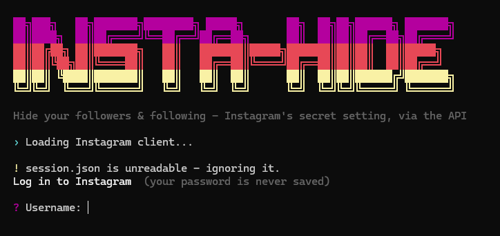
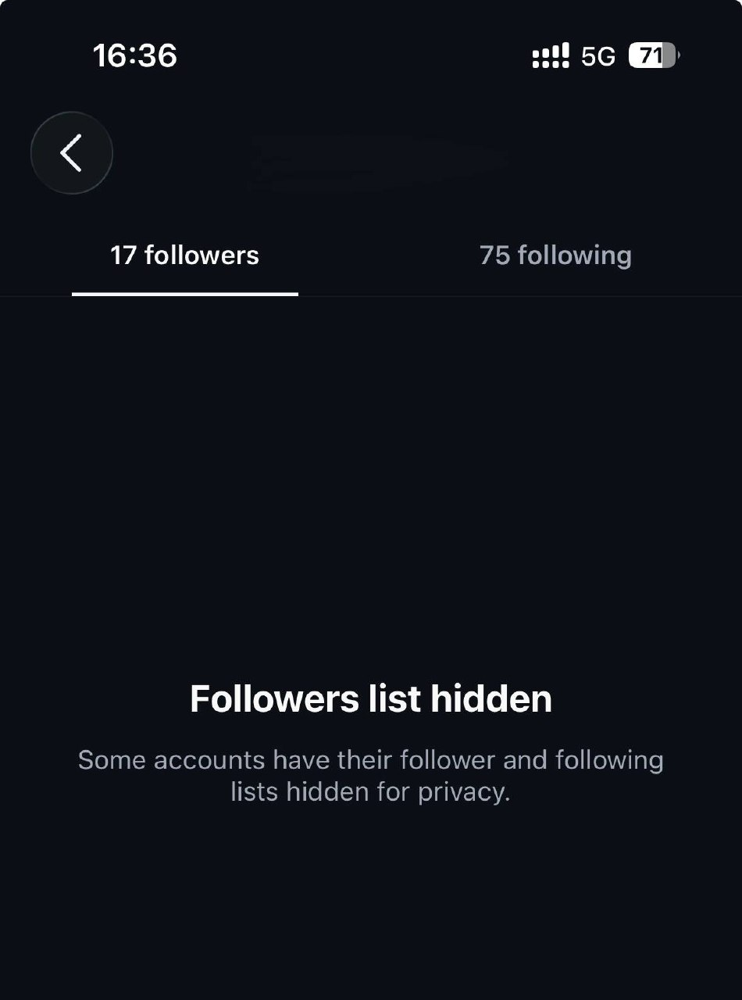

<div align="center">

```text
██╗███╗   ██╗███████╗████████╗ █████╗       ██╗  ██╗██╗██████╗ ███████╗
██║████╗  ██║██╔════╝╚══██╔══╝██╔══██╗      ██║  ██║██║██╔══██╗██╔════╝
██║██╔██╗ ██║███████╗   ██║   ███████║█████╗███████║██║██║  ██║█████╗
██║██║╚██╗██║╚════██║   ██║   ██╔══██║╚════╝██╔══██║██║██║  ██║██╔══╝
██║██║ ╚████║███████║   ██║   ██║  ██║      ██║  ██║██║██████╔╝███████╗
╚═╝╚═╝  ╚═══╝╚══════╝   ╚═╝   ╚═╝  ╚═╝      ╚═╝  ╚═╝╚═╝╚═════╝ ╚══════╝
```

# insta-hide: Hide Followers and Following on Instagram

**Hide your followers list and following list on Instagram, and even hide yourself from other people's lists.**
Instagram's secret privacy setting, unlocked through the API. Free, one Python file.


[Screenshots](#-screenshots) · [Features](#-features) · [What you can hide](#-what-you-can-hide) · [Quick start](#-quick-start) · [Tutorial](#-tutorial) · [FAQ](#-faq) · [Troubleshooting](#-troubleshooting)

</div>

---

Want to **hide who you follow on Instagram**? Or **hide your followers list** so nobody can scroll through it? Instagram has a built-in setting that does exactly that: it **hides your followers and following lists** from other people. But the app doesn't show it to most accounts, and there's no button for it.

**insta-hide** switches that hidden setting **on or off** from your computer. You don't have to make your account private, and you don't have to remove or block anyone. It also includes a second setting that **hides you from other people's followers and following lists**.

## 📸 Screenshots

<table>
  <tr>
    <td align="center" width="60%">
      <br>
      <sub><b>insta-hide</b> running in the terminal</sub>
    </td>
    <td align="center" width="40%">
      <br>
      <sub>The result in the Instagram app: <b>"Followers list hidden"</b></sub>
    </td>
  </tr>
</table>

After running insta-hide, anyone who opens your followers or following list sees **"Followers list hidden: Some accounts have their follower and following lists hidden for privacy."** Your follower and following **counts stay visible**. Only the lists are hidden.

## ✨ Features

- 🙈 **Hide your followers list** on Instagram
- 🙈 **Hide your following list** (who you follow) on Instagram
- 👻 **Hide yourself from other people's followers and following lists** *(beta)*
- 👀 **Check your status.** It shows whether each setting is currently `HIDDEN` or `VISIBLE`.
- 🔁 **Undo anytime.** Make your lists visible again with one keypress.
- ✅ **Confirms every change** by reading the setting back from Instagram.
- 🔐 **2FA login support.** Works with authenticator apps, SMS codes, and backup codes, and only asks for a code if your account has 2FA on.
- 💾 **Saved session.** Log in once and skip the login next time. Your password is never saved.
- 🎨 **Clean, colorful terminal menu.** Pick a number and answer Y/N.
- 📦 **One file, no config.** No `.env` and no API keys. Just `python hide.py`.

## 🔒 What you can hide

| # | In the menu | Instagram setting | What it does | Status |
|---|---|---|---|---|
| 1 | Followers & following lists | `hide_followers_following_list` | Hides **your followers list and your following list** from other people | ✅ Works |
| 2 | You on other people's lists | `hide_self_from_others_lists` | Hides **you** from **other people's** followers and following lists | 🧪 Beta |

### 1. Hide your followers and following lists

Turns on Instagram's setting that **hides the list of people who follow you and the list of people you follow**. Your account can stay **public**: your posts stay visible, and only the lists are hidden. Turn it off anytime to make the lists visible again.

### 2. Hide yourself from other people's lists *(beta)*

Instagram also has a setting that **removes you from other accounts' followers and following lists**. When someone opens a friend's followers or following list, you won't appear in it. insta-hide can turn this on and off, but it hasn't been confirmed to work on every account yet. That's why it's marked **beta**.

> [!NOTE]
> After every change, insta-hide reads the setting back to confirm **Instagram saved it**. What other people actually see is decided by Instagram, so check from a second account if you want to be sure.

## ⚡ Quick start

```bash
git clone https://github.com/culturally/insta-hide.git
cd insta-hide
pip install -r requirements.txt
python hide.py
```

New to this? Follow the step-by-step tutorial below. 👇

---

## 📖 Tutorial

### Step 1: Install Python

You need **Python 3.11 or newer**.

- **Windows:** download it from [python.org/downloads](https://www.python.org/downloads/). During setup, **tick "Add python.exe to PATH"**.
- **macOS:** `brew install python`, or use the installer from python.org.
- **Linux:** usually already installed. Check with `python3 --version`.

### Step 2: Download insta-hide

Either clone it with git:

```bash
git clone https://github.com/culturally/insta-hide.git
```

or click **Code → Download ZIP** on GitHub and unzip it.

### Step 3: Open a terminal in the folder

- **Windows:** open the `insta-hide` folder, click the address bar, type `cmd`, and press Enter.
- **macOS / Linux:** `cd` into the `insta-hide` folder.

### Step 4: Install the requirements

```bash
pip install -r requirements.txt
```

> On macOS/Linux, use `pip3` and `python3` if `pip` and `python` don't work.

### Step 5: Run it

```bash
python hide.py
```

### Step 6: Log in to Instagram

Type your Instagram username and password. The password stays hidden while you type.

```text
  Log in to Instagram  (your password is never saved)

  ? Username: yourname
  ? Password (hidden):
  › Logging in...
  ✔ Logged in as @yourname
  ? Save session so you don't need to log in next time? [Y/n] y
  ✔ Session saved to session.json
```

**No 2FA?** You're in. No code is needed.

**2FA on?** insta-hide detects it automatically and asks for your code. It also tells you where the code comes from:

```text
  › Logging in...

  Two-factor authentication is on for this account
  › Enter the 6-digit code Instagram texted to +** *** ***42.
  › An 8-digit backup code works too. If a new SMS arrives, use the newest code.
  ? 2FA code (Enter to cancel): 123456
  › Verifying code...
  ✔ Logged in as @yourname
```

- Works with **authenticator apps**, **SMS**, and **8-digit backup codes**.
- Typed it wrong? You get **3 tries** before it stops, and you don't need to retype your password.
- Spaces and dashes are fine (`123 456` or `123-456`).
- Save the session afterwards, and you won't need the code again next time.

**"Confirm this login"?** Open the Instagram app, tap **"This was me"**, then run `python hide.py` again.

### Step 7: Hide your followers and following lists

You'll see your current settings:

```text
  ─── @yourname ────────────────────────────────────────────
   1  Followers & following lists         ○ VISIBLE
   2  You on other people's lists BETA    ○ VISIBLE
  ──────────────────────────────────────────────────────────
   R refresh   L log out   Q quit
```

Type **`1`**, then **`y`**:

```text
  ? Choose: 1

  Followers & following lists currently ○ VISIBLE
  ? Hide your followers & following lists? [y/N] y
  › Updating...
  ✔ Followers & following lists is now ● HIDDEN
```

Done. Your **followers and following lists are now hidden**. 🎉

### Step 8: Hide yourself from other people's lists (optional, beta)

Type **`2`**, then **`y`**:

```text
  ? Choose: 2

  You on other people's lists currently ○ VISIBLE
  ? Hide yourself from other people's follower/following lists? [y/N] y
  ! Beta: this setting is not confirmed to work on every account.
  › Updating...
  ✔ You on other people's lists is now ● HIDDEN
```

### Step 9: Show your lists again (undo)

Run `python hide.py`, type the number again (`1` or `2`), and answer **`y`**:

```text
  ? Make your followers & following lists visible again? [y/N] y
  ✔ Followers & following lists is now ○ VISIBLE
```

If you saved your session in Step 6, you won't need to log in again.

### Menu keys

| Key | What it does |
|---|---|
| `1` | Hide / show your followers & following lists |
| `2` | Hide / show yourself on other people's lists *(beta)* |
| `R` | Re-check the current settings |
| `L` | Log out and delete `session.json` |
| `Q` | Quit |

---

## 💾 Saved session

If you answer **yes** to *"Save session?"*, insta-hide writes a `session.json` next to `hide.py`, and the next run logs you straight in.

- Your **password is never saved**, only the login session (cookies and tokens).
- `session.json` is plain JSON and **is not encrypted**. Anyone with that file can use your account, so don't share or upload it. It's already in `.gitignore`.
- **Log out:** press `L` in the menu, or delete `session.json`.
- If the session expires, insta-hide notices and asks you to log in again.

> [!TIP]
> Deleting `session.json` doesn't end the session on Instagram's side. To fully revoke it, open **Accounts Center → Password and security → Where you're logged in** in the app.

## ❓ FAQ

### How do I hide my followers and following on Instagram?
Run `python hide.py`, log in, press `1`, and answer `y`. Your followers list and following list are hidden. See the [tutorial](#-tutorial).

### Can I hide who I follow on Instagram without going private?
Yes. The setting only hides the **lists**. Your account stays public and your posts stay visible.

### Can I hide my followers list but keep my account public?
Yes. That's exactly what setting `1` does.

### Will people still see my follower and following count?
Yes. The numbers stay visible. Only the **lists** are hidden, and people who open them see *"Followers list hidden"* (see the [screenshot](#-screenshots)).

### How do I hide myself from someone else's followers or following list?
Use setting `2`, *"You on other people's lists"*. It hides you from other people's followers and following lists. It's still in **beta**.

### Why can't I find this setting in the Instagram app?
Instagram hasn't made it available to every account in the app. insta-hide changes the same setting directly through Instagram's API.

### Do I need to remove followers or block anyone?
No. Nobody gets removed or blocked. The lists are just hidden, and you can undo it anytime.

### Does it work with two-factor authentication (2FA)?
Yes. It works with authenticator apps, SMS codes, and 8-digit backup codes. If your account doesn't use 2FA, it never asks for a code.

### Does it work on iPhone or Android?
insta-hide runs on a **computer** (Windows, macOS, or Linux). The setting applies to your Instagram account, so it takes effect everywhere, including the iPhone and Android apps.

### Is my password saved?
No. Only the login session is saved, and only if you choose to save it. See [Saved session](#-saved-session).

### Is it safe? Can my account get banned?
insta-hide only changes a privacy setting on **your own account**, and it only sends a few requests. It still uses Instagram's unofficial private API, so a small risk always remains. Don't spam the toggle.

### Is it free?
Yes, completely free.

## 🧰 Troubleshooting

| Message | Fix |
|---|---|
| `'python' is not recognized` | Reinstall Python and tick **"Add python.exe to PATH"**, or use `py hide.py` on Windows. |
| `instagrapi is not installed` | Run `pip install -r requirements.txt`. |
| `Instagram wants you to confirm this login` | Approve the login in the Instagram app ("This was me"), then run again. |
| `The 2FA code didn't work after 3 tries` | Use the newest code. Authenticator codes change every 30 seconds. Wait a minute, then run again. |
| `Instagram is rate-limiting you` | Wait a few minutes. Don't spam the toggle. |
| `Your session expired` | Press `L` (or delete `session.json`) and log in again. |
| `Instagram rejected the request` | Your account may not support the setting, or Instagram changed the API. |

## ⚠️ Disclaimer

insta-hide uses Instagram's **private mobile API** through [instagrapi](https://github.com/subzeroid/instagrapi). It is not affiliated with, endorsed by, or connected to Instagram or Meta. Instagram can change or block the API at any time. Use it only on **your own account** and at your own risk.

## 📦 Third-party

insta-hide is built on [instagrapi](https://github.com/subzeroid/instagrapi) and [colorama](https://github.com/tartley/colorama). Their licenses are listed in [THIRD_PARTY.md](THIRD_PARTY.md).

---

<div align="center">
<sub>
insta-hide · hide followers on Instagram · hide following list on Instagram · hide followers and following from Instagram account · hide who you follow on Instagram · hide yourself from someone's followers list · Instagram privacy tool · Instagram hide followers Python script · instagrapi
</sub>
</div>
